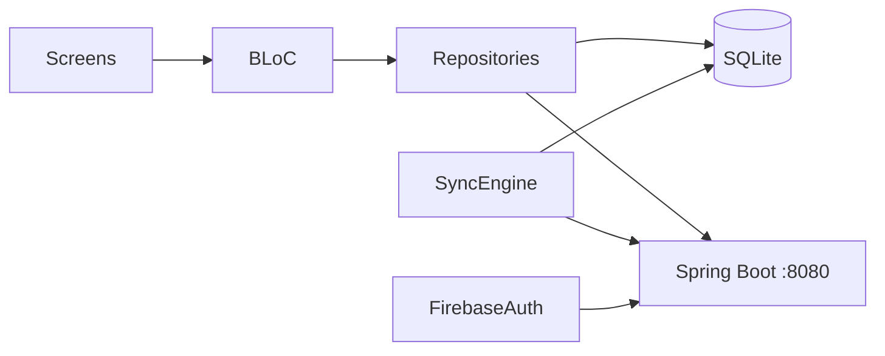

# Field Note

Interview home task: an **offline-first field-engineering app**. Field staff capture customers, job sites, and notes (GPS, photos, status) with no network, then sync to a REST backend when connectivity returns.

This repository is the **Flutter client**. The API lives next to it:

```
D:\flutter\field_note            ← this app
D:\flutter\field_note_backend    ← Spring Boot + PostgreSQL
```

---

## Table of contents

1. [Problem and solution](#problem-and-solution)
2. [Features](#features)
3. [Architecture](#architecture)
4. [How the two apps talk](#how-the-two-apps-talk)
5. [Prerequisites](#prerequisites)
6. [How to run the full project](#how-to-run-the-full-project)
7. [Project structure](#project-structure)
8. [Data model](#data-model)
9. [Configuration](#configuration)
10. [Tech stack](#tech-stack)

---

## Problem and solution

Engineers on site often have poor connectivity. The app must:

- Create and edit records **offline**
- Keep a clear **sync status**
- Reconcile with the server **without losing local work**
- Isolate each user’s data on the backend

**Approach:** SQLite is the source of truth on the device. Repositories write locally with `sync_status = pending` when the API is unreachable. A `SyncEngine` batches pending customers, sites, and notes to `POST /api/sync/push`, then list screens refresh from `GET /api/customers|sites|notes`. Photos upload to `POST /api/notes/{id}/photo` after a successful push.

---

## Features

| Area | What the user gets |
| --- | --- |
| Auth | Email/password via **Firebase Auth**. The ID token is sent as `Authorization: Bearer …` on every API call. After login/register, the client upserts the user at `POST /api/auth/register`. |
| Offline | Local SQLite (`field_notes.db`). Work continues without the backend. |
| Sync | Online/offline badge, **Sync now**, and auto-sync when the network returns. |
| Domain | **Customer → Site → Field note**. Notes have title, description, date, status (`DRAFT` / `IN_PROGRESS` / `COMPLETED`), GPS, and a photo. |
| Notes UX | Search, status filters, dashboard stats, recent notes. |
| Map | OpenStreetMap pin via `flutter_map` (no Google Maps key). |
| Export | PDF generate, print, and share. |
| Settings | Light/dark theme, default note status, auto-sync, force-offline preference. Logout keeps local SQLite. |

**Tabs:** Dashboard · Notes · Sites · Customers · Settings (login/register sit in front of this shell).

---

## Architecture

Feature-first Flutter with **BLoC**, **GetIt**, and repository layers.

```
lib/
├── main.dart                      # Firebase, SQLite web factory, DI, AuthGate
├── firebase_options.dart          # FlutterFire
├── core/
│   ├── constants/api_constants.dart
│   ├── database/                  # SQLite helper + DAOs
│   ├── di/injection_container.dart
│   ├── network/                   # Dio + Firebase token interceptor
│   ├── services/                  # connectivity, GPS, SyncEngine, PDF
│   └── theme/
└── features/
    ├── auth/
    ├── customers/
    ├── sites/
    ├── field_notes/
    ├── home/                      # dashboard + bottom navigation
    └── settings/
```

Each feature typically has `models/`, `data/` (remote source + repository), `bloc/`, and `presentation/`.



**Write path**

1. Online and API succeeds → persist remotely, then store as `synced`.
2. Offline or API error → store locally as `pending`.
3. Soft delete sets `deleted_at` and syncs that flag on push.

**Web:** `sqflite_common_ffi_web` is used. The web schema omits foreign keys and indexes (unsupported by that factory). Schema upgrades drop and recreate tables (development-friendly; local web data is wiped on version bump).

---

## How the two apps talk

| Client | Backend |
| --- | --- |
| Firebase sign-in | `FirebaseTokenFilter` verifies the ID token |
| `POST /api/auth/register` | Upserts `users` by `firebase_uid` (no passwords in PostgreSQL) |
| CRUD `/api/customers`, `/api/sites`, `/api/notes` | Scoped to the authenticated user |
| `GET /api/notes?siteId=&status=&q=` | Filter / search |
| `POST /api/sync/push` | Batch upsert by client UUID |
| `GET /api/sync/pull?since=` | Delta or full pull (API exists; the app currently refreshes via list endpoints after push) |
| `POST /api/notes/{id}/photo` | Multipart file; public URL under `/api/photos/**` |

Base URL (`lib/core/constants/api_constants.dart`):

- Chrome / desktop: `http://localhost:8080/api`
- Android emulator: `http://10.0.2.2:8080/api`

On a **physical phone**, replace that host with your PC’s LAN IP.

---

## Prerequisites

| Tool | Version / notes |
| --- | --- |
| Flutter | Dart SDK **^3.13.2** (`flutter doctor` should be clean) |
| JDK | **21** (backend) |
| Maven | Wrapper `mvnw.cmd` is in the backend repo |
| PostgreSQL | **14+**, local instance on port **5432** |
| Firebase | Same project for app + backend. Email/password sign-in enabled. |

---

## How to run the full project

Do these steps in order. The app still opens without the API (offline mode), but login registration against PostgreSQL and cloud sync need the backend.

### 1. PostgreSQL

Create the database (Flyway creates tables on first start):

```sql
CREATE DATABASE field_notes;
```

Match credentials in `field_note_backend/src/main/resources/application.yml`:

```yaml
spring:
  datasource:
    url: jdbc:postgresql://localhost:5432/field_notes
    username: postgres
    password: <your-postgres-password>
```

### 2. Firebase (once)

**Client (this repo)** is already wired with FlutterFire (`lib/firebase_options.dart`, `android/app/google-services.json`). In the Firebase console, enable **Authentication → Email/Password**.

**Backend** needs a service account file that is **gitignored**:

1. Firebase console → Project settings → Service accounts → **Generate new private key**
2. Save as:

```
D:\flutter\field_note_backend\src\main\resources\firebase-service-account.json
```

Use the **same Firebase project** as the Flutter app so ID tokens verify.

### 3. Start the backend

```powershell
cd D:\flutter\field_note_backend
.\mvnw.cmd spring-boot:run
```

Wait until the log shows Tomcat on **port 8080**. First boot runs Flyway (`V1__init.sql`: `users`, `customers`, `sites`, `field_notes`, indexes, `pgcrypto`).

Photos are written to `field_note_backend/uploads/photos/` and served at `http://localhost:8080/api/photos/{filename}`.

### 4. Start the Flutter app

```powershell
cd D:\flutter\field_note
flutter pub get
flutter run
```

Useful targets:

```powershell
flutter run -d chrome
flutter run -d windows
flutter run -d emulator-5554
```

Create an account on the register screen, then add a customer → site → note. Toggle airplane mode to confirm offline writes; use **Sync now** when back online.

### 5. Verify

| Check | Expected |
| --- | --- |
| Backend | `http://localhost:8080` accepts requests (unauthenticated APIs return 401 except register/photos) |
| Login | Firebase user created; row appears in `users` |
| Offline note | List shows pending sync on the dashboard |
| Sync | Snackbar with counts; `sync_status` becomes `synced` |
| Photo | File under `uploads/photos`; `photo_url` on the note |

### Tests and analysis (optional)

```powershell
cd D:\flutter\field_note
flutter analyze
flutter test
```

`test/widget_test.dart` is still the default Flutter stub.

```powershell
cd D:\flutter\field_note_backend
.\mvnw.cmd test
```

---

## Project structure

See [Architecture](#architecture). Notable services:

- `SyncEngine` — batches pending rows to `/sync/push`, then uploads pending photos
- `AuthInterceptor` — attaches Firebase ID token
- `PdfExportService` — A4 report, share on mobile/desktop, print preview on web
- `LocationService` — Geolocator for new notes

---

## Data model

Local SQLite mirrors the server, plus `sync_status`.

| Entity | Fields |
| --- | --- |
| Customer | name, phone, email, address |
| Site | customer_id, name, address |
| Field note | site_id, title, description, lat/lng, note_date, status, photo_path, photo_url |

Every row has `id` (UUID), timestamps, optional `deleted_at`. Native SQLite uses `ON DELETE CASCADE` and indexes on site/customer/status. Server rows also have `user_id` (not stored in the same way on the client; isolation is enforced by the API).

---

## Configuration

| Item | Where |
| --- | --- |
| API host | `lib/core/constants/api_constants.dart` |
| Theme | `lib/core/theme/` |
| Android permissions | Internet, location, camera, media (`AndroidManifest.xml`) |
| Cleartext HTTP | Android 9+ may block `http://`. For a physical device talking to `http://192.168.x.x:8080`, set `android:usesCleartextTraffic="true"` on `<application>` or add a network security config. Prefer HTTPS in production. |

Hive is listed in `pubspec.yaml` but unused; persistence is SQLite + SharedPreferences.

---

## Tech stack

Flutter, flutter_bloc, GetIt, Dio, sqflite, Firebase Auth, Geolocator, image_picker, flutter_map, pdf / printing / share_plus, Google Fonts, SharedPreferences.

**Version:** 1.0.0+1 · package `field_note` (`publish_to: none`).
